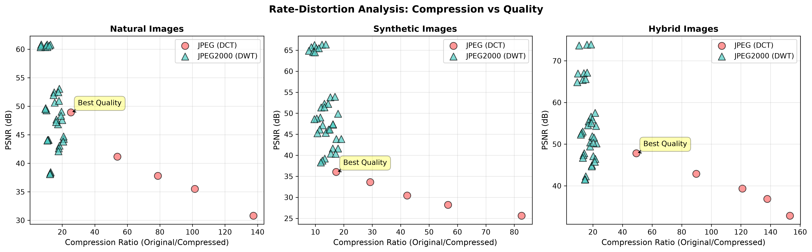

# JPEG / JPEG2000 Compression Studio

A desktop application and analysis toolkit that implements **JPEG-style (DCT)** and **JPEG2000-style (DWT)** image compression from the ground up in Python, and compares how each method trades file size for image quality across different kinds of images.

Built as a team project for **CENG 384 – Digital Signal Processing** at Ankara Bilim University.



<!-- Add a GUI screenshot here:  -->

## Features

- **Two lossy pipelines, implemented step by step**
  - JPEG-style: 8×8 block DCT → quantization → entropy coding
  - JPEG2000-style: multi-level 2D DWT (Haar, Daubechies, biorthogonal and custom **PR-QMF** filter banks) → quantization → entropy coding
- **Lossless mode** for content where every pixel matters (e.g. medical or biometric images)
- **Custom Huffman codec** with per-subband entropy coding and real bitstream size calculation
- **Custom bitstream format** with an encoder/decoder round trip
- **Quality metrics:** PSNR, MSE, SSIM, bits per pixel (BPP) and compression ratio
- **Rate–distortion analysis** across natural, synthetic and hybrid images, exported as JSON/CSV with charts
- **Desktop GUI (CustomTkinter):** side-by-side original vs. reconstructed image, DWT subband view, histograms and a live metrics table
- **Automated tests** with pytest (unit + end-to-end pipeline)

## Tech stack

Python · NumPy · SciPy · OpenCV · PyWavelets · scikit-image · Matplotlib · pandas · CustomTkinter · pytest

## Project structure

```
compression_gui.py              # Desktop GUI (entry point)
jpeg_jpeg2000_stage1.py         # Image preprocessing + DWT transformer
huffman_codec.py                # Huffman entropy coding
stages/                         # Compression pipeline, one module per stage
  stage1_preprocessing.py         load, resize, color conversion
  stage_dct_transform.py          JPEG-style DCT pipeline
  stage2_quantization.py          quantization
  stage3_huffman_coding.py        entropy coding
  stage4_bitstream.py             bitstream packaging
  stage5_decoder.py               decoding & reconstruction
  stage6_metrics.py               PSNR / SSIM / MSE / BPP
  stage_lossless.py               lossless pipeline
core/                           # Config, PR-QMF filters, rate-distortion, image classifier, utils
image_comparison_analyzer.py    # Batch rate-distortion analysis
compression_analysis_visualizer.py  # Charts from analysis results
generate_test_images.py         # Synthetic test images (natural / synthetic / hybrid)
tests/                          # pytest unit + integration tests
```

## Getting started

Requires Python 3.11+.

```bash
python -m venv .venv
# Windows: .venv\Scripts\activate    macOS/Linux: source .venv/bin/activate
pip install -r requirements.txt

python compression_gui.py           # launch the desktop app
```

Run the analysis from the command line:

```bash
python generate_test_images.py                 # create the sample images
python image_comparison_analyzer.py            # analyze them (or pass your own image paths)
python compression_analysis_visualizer.py      # build the charts
```

Run the tests:

```bash
pip install -r requirements-dev.txt
pytest
```

More detail on the analysis methodology: [COMPRESSION_ANALYSIS_README.md](COMPRESSION_ANALYSIS_README.md) · [QUICK_START.md](QUICK_START.md)

## My contribution

This was a team project. I was responsible for the **DWT (JPEG2000-style) part**: image preprocessing and the multi-level 2D wavelet transform (`jpeg_jpeg2000_stage1.py`), wavelet and filter-bank options including the custom **PR-QMF** filters (`core/pr_qmf.py`), and the DWT subband visualization. Other parts of the pipeline were built by my teammates.

> Note: some code comments are in Turkish, as the project was developed for a Turkish university course.

## Author

**Hüseyin Emir** · [Upwork](https://www.upwork.com/freelancers/~01af5e97c6c577ecd8) · [GitHub](https://github.com/Noxastrum029)
